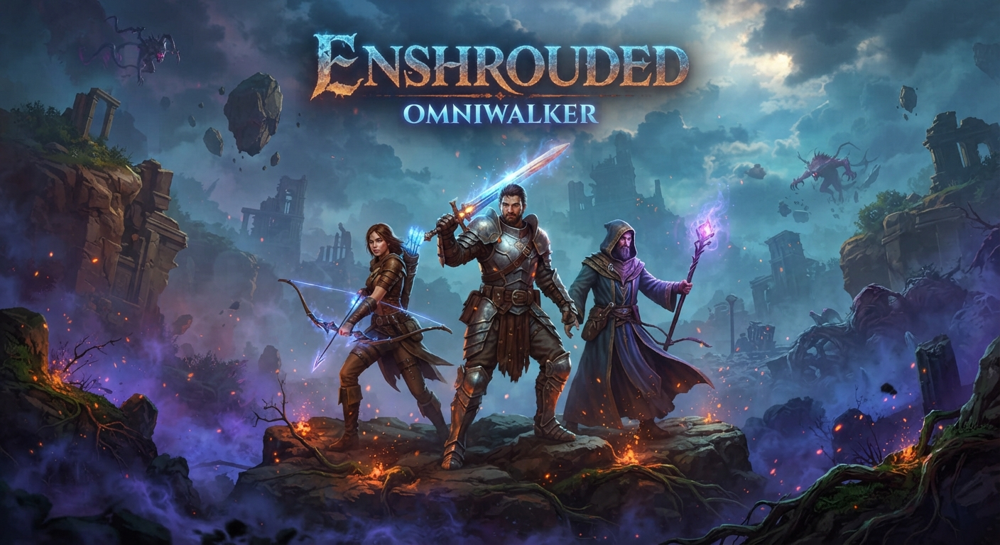

# 🛡️ Enshrouded: Ultimate QoL & Customization Mod Collection

  

  

  
  
  
  

  <b>⬇ DOWNLOAD THE MOD PACK ⬇</b>

  

  
  

  

> 🛡️ **Your complete toolkit for Enshrouded** — build without limits, explore the Shroud safely, and manage your world with admin tools. Designed for **solo and private co-op** play. 🛡️ **NO MEMORY INJECTION** — this repository contains client-side mods and admin panels only. No aimbots or game-breaking cheats.

## 📖 About the Game

**Enshrouded** is a survival action RPG set in the ruined realm of Embervale. You are a Flameborn, the last hope of a dying race, tasked with surviving the deadly Shroud, building bases, and uncovering the mysteries of a fallen civilization.

The game features voxel-based building, deep crafting, skill trees, and challenging combat against the creatures of the mist.

## ⚠️ IMPORTANT WARNING — READ BEFORE USING

**Enshrouded is primarily a single-player and co-op survival game.**

| Enforcement Risk | Details |
|------------------|---------|
| **Solo & Co-op Safe** | No competitive anti-cheat system |
| **Client-Side Mods** | This repository focuses on mods that modify local files or use admin panels |
| **Ban Risk** | **ZERO in solo/private co-op** — no public competitive modes |
| **Multiplayer Caution** | Using admin tools in public servers may get you kicked by the host |

> ⚠️ **Important**: The game has no anti-cheat. However, using **memory editors** can corrupt saves. This repository prioritizes **safe, client-side mods** and **admin panels** that enhance the experience without breaking the game. Always back up saves.

## 🔒 Safety & Security

| Safety Feature | Description |
|----------------|-------------|
| **No Memory Injection** | Focus on mod loaders and external admin panels |
| **Client-Side Focused** | Mods modify local files or use built-in admin commands |
| **No Network Code** | Mods contain no telemetry or online hooks |
| **Backup Recommended** | Always back up saves before installing major mods |

## 🔥 Featured Mods

### 🎮 M182 Admin Panel MOD

**Source:** Ali213 | **Version:** M182 | **Updated:** October 22, 2026

A powerful in-game admin panel for server management and solo debugging. It provides a callable interface for spawning creatures, items, and managing world settings.

**Features**:
- **Creature Spawner** — Spawn any enemy or boss by name, adjust level, health, and damage
- **Item Spawner** — Browse all items, modify weapon/armor stats, and add directly to inventory
- **God Mode** — Invincibility, infinite stamina/mana, instant heal
- **World Controls** — Time and weather manipulation, global balance settings
- **Teleport & Save Coordinates** — Set safe zones and team areas
- **PvP/Safe Zone Management** — Toggle PvP, create safe zones that heal players

**Installation**:
1. Close the game.
2. Copy the main files to the game folder (next to `enshrouded.exe`).
3. Launch the game once and load your world to populate the export folder.
4. Press `Insert` to open the panel.

> ⚠️ **Note**: This mod includes a modified `dbghelp.dll` (EML loader). If you have other mods, install this one last. If the game crashes, try deleting the `modszz_m182_item_stats` folder.

### 🛠️ Enshrouded-Forge Companion (Open Source)

**Source:** GitHub | **Updated:** October 23, 2026

An external companion tool that hooks into the game's process memory without modifying any game files. It features version-matched offsets and a portable configuration.

**Features**:
- **God Mode** — Intercepts incoming damage
- **Resource Management** — Pins inventory counters to safe values
- **Movement Modifiers** — Adjust player transform after physics step
- **Overlay Menu** — Separate topmost window, invisible to game UI
- **No Network Requests** — Fully local operation

**How It Works**:
- Runs external to the game
- Hooks into memory and input layer
- No file injection or executable patching
- Session state evaporates on close

> ⚠️ **Note**: This is a companion trainer. Use in solo or private co-op only. The GitHub repository provides the source code for transparency.

### ⚙️ Cheat Engine Tables (Community)

**Source:** PlayGround.ru, VGTimes | **Type:** Cheat Engine Tables

Several community tables are available for advanced customization.

| Table | Key Features |
|-------|--------------|
| **sergey979 (+21)** | Infinite Health/Stamina/Mana, Free Craft, High Speed/Jump, Infinite Jumps, Glider Flight, Flying, No Fall Damage, Build Area Increase |
| **Hadrogallous (+7)** | Infinite Shroud, No Fall Damage, Infinite Consumables, Infinite Stack Splitting, Underwater Breath |

**How to Use**:
1. Open Cheat Engine and load the table.
2. Attach to the Enshrouded process.
3. Check desired options.

### 🧪 Nexus Mods (Safe QoL)

**Source:** Nexus Mods

Nexus Mods hosts several safe, file-based mods for Enshrouded.

| Mod | Description |
|-----|-------------|
| **Infinite Altars Flame** | Allows placing more altars (tested up to 83 before crash) |
| **Various QoL** | Community-created mods for UI, building, and survival tweaks |

## 🚀 QUICK START

### Method 1 — M182 Admin Panel (Recommended for Solo)

1. **Download** the M182 Admin Panel archive.
2. **Close** the game completely.
3. **Copy** the files to your Enshrouded folder (where `enshrouded.exe` is located).
4. **Launch** the game and load your world.
5. **Press `Insert`** to open the panel.

> ⚠️ **Important**: Do not touch keyboard/mouse while the mod is writing commands (takes ~15 seconds).

### Method 2 — Enshrouded-Forge Companion (External)

1. **Download** the companion from GitHub.
2. **Extract** to any folder.
3. **Launch** the game first.
4. **Run** the companion and attach to the process.
5. **Use the overlay** to toggle features.

### Method 3 — Cheat Engine Tables

1. **Download** Cheat Engine 7.5+ from the official website.
2. **Download** the `.CT` table from the button above.
3. **Open** Cheat Engine and load the table.
4. **Attach** to the Enshrouded process.
5. **Check** desired options.

## 📊 KEY FACTS

| Metric | Value |
|--------|-------|
| **Mod Type** | Admin Panel / External Companion / CE Tables |
| **Memory Injection** | External tools only (no file injection) |
| **Co-op Safe** | Client-side features yes; world state depends on host |
| **Supported Version** | Version 1.0 (2026) |

## ❓ FAQ

### ❓ Is this a cheat or trainer?
**No.** This repository focuses on **admin panels, external companions, and Cheat Engine tables** for customization and debugging. It does not contain aimbots or game-breaking cheats.

### ❓ Will I get banned?
**No.** Enshrouded has no anti-cheat. Use mods freely in solo or private co-op.

### ❓ Does it work with the latest patch?
**Yes.** The mods listed are updated for the 2026 version (Version 1.0).

### ❓ Does it work on Windows 11?
**Yes.** Fully compatible with Windows 10 and 11 (64-bit).

### ❓ Can I use mods in co-op?
**Yes, but be careful.** Client-side mods (like visual tweaks) are safe. World-state changes (like item spawning) may desync or be rejected by the host.

### ❓ How to uninstall?
- M182 Panel: Delete the copied files and the `export` folder.
- Forge: Delete the companion folder.
- CE Tables: Delete the `.CT` file.

## 🛠️ System Requirements

| Component | Minimum | Recommended |
|-----------|---------|-------------|
| **OS** | Windows 10 (64-bit) | Windows 11 (64-bit) |
| **Processor** | Intel Core i5-6600 / AMD Ryzen 5 2600 | Intel Core i7-8700 / AMD Ryzen 7 3700X |
| **RAM** | 16 GB | 16 GB+ |
| **GPU** | NVIDIA GTX 1060 / AMD RX 580 | NVIDIA RTX 2060+ / AMD RX 6600+ |
| **Storage** | 60 GB (game) + 100 MB (mods) | 60 GB SSD (game) + 100 MB (mods) |

## 📢 Disclaimer

> **Fan-made mod collection.** Not affiliated with Enshrouded developers, Keen Games, or any publisher.
>
> **Use at your own risk.** The author is not responsible for save corruption, crashes, or damage.
>
> **Solo and private co-op only** — use responsibly.
>
> **Back up your saves before use!**

## 🌟 Support This Project

- ⭐ **Star** this repository
- 🔔 **Watch** for updates
- 🐞 **Report** issues
- 💬 **Share** with friends!

© 2026 • Enshrouded • QoL & Customization Mods
